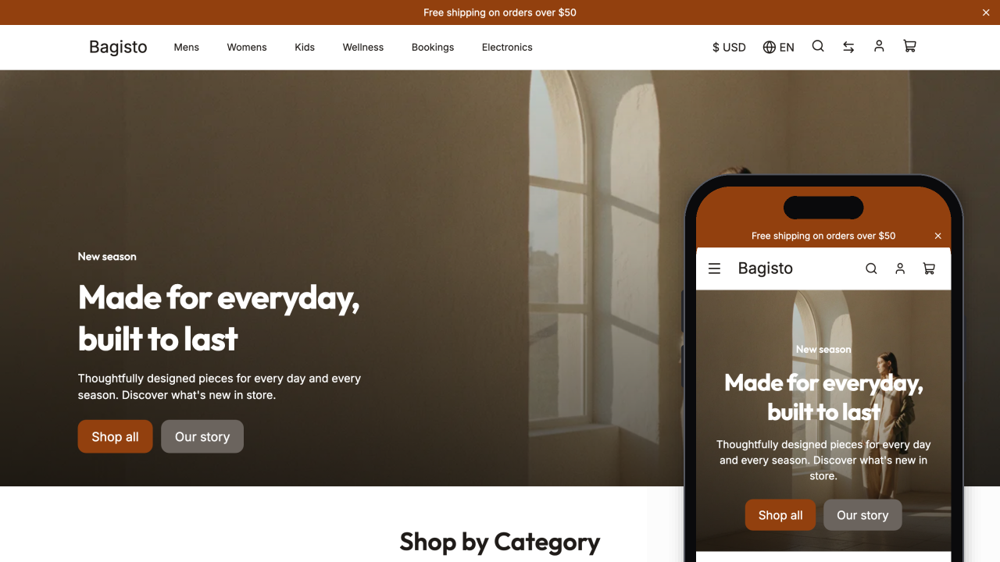

# Visual Debut

**Visual Debut** is the official reference theme for [Bagisto Visual](https://github.com/bagistoplus/visual). It is a complete Bagisto storefront that merchants customize in the visual editor, built with Alpine.js and Livewire for a fast, responsive store.



**Live demo:** [demo.bagistoplus.com](https://demo.bagistoplus.com)

## Requirements

| | Supported versions |
| --- | --- |
| Bagisto | 2.3, 2.4 and 2.5 |
| PHP | 8.2 or later |
| Laravel | 11, 12 and 13 |
| Bagisto Visual | 2.0 (alpha) |

Some Bagisto features only exist in newer releases. Debut supports each one when the installed Bagisto provides it, and leaves it out otherwise (see [Bagisto features](#bagisto-features)).

## Product types

Every Bagisto product type has its own buying experience on the product page:

| Type | What the shopper gets |
| --- | --- |
| Simple and virtual | Quantity and buy buttons |
| Configurable | A variant picker with dropdown, colour, image and text swatches; price and gallery follow the chosen variant, and unavailable combinations are marked |
| Grouped | A quantity for each product in the group |
| Bundle | Option selection with the bundle price updated as options change |
| Downloadable | Link selection, with samples to preview |
| Booking | Default and appointment slots, events with tickets, rentals and table reservations |

Customizable options set on any product are shown and validated before the product is added to the cart.

## Features

### Storefront

- **Visual editor ready:** every page is built from sections and blocks the merchant can add, reorder and style, with theme settings for colours, colour schemes and typography.
- **Product page:** media gallery with zoom and video, reviews with photos, and sections for related products and up-sells.
- **Category and search:** filters for price and attributes, sorting, grid and list views, image search, and a message when nothing matches.
- **Cart and checkout:** mini cart, shipping estimate, coupons, and a one-page checkout. Prices, subtotals, shipping and taxes follow the store's tax display settings, including the per-rate tax breakdown.
- **Customer account:** orders, addresses, profile, wishlist, reviews, downloadable products and product comparison.
- **Custom code:** the custom CSS and JavaScript set in Bagisto's configuration are added to every page.

### Bagisto features

These appear when the installed Bagisto version includes them:

- **GDPR:** cookie consent and customer data requests.
- **Returns (RMA):** return requests and their follow-up from the customer account.
- **EU right of withdrawal:** withdrawal requests for customers and guests.
- **Lowest price before a discount** (EU Omnibus Directive, Bagisto 2.5).
- **WebMCP tools** for AI agents (Bagisto 2.4.8 and later).

### Quality

- **Performance:** responsive WebP images, lazy loading, fonts that do not block rendering, and scripts loaded only by the pages that use them.
- **Accessibility:** semantic headings, labelled controls and keyboard friendly menus and dialogs.
- **International:** right to left layouts, every Bagisto currency, and translations in English, French, Arabic and Hindi.

## Getting started

### 1. Install Bagisto Visual

Install [Bagisto Visual](https://github.com/bagistoplus/visual) in your Bagisto project first, following its installation guide.

### 2. Install the theme

While Bagisto Visual is in alpha, your project needs to accept pre-release packages:

```bash
composer config minimum-stability dev && composer config prefer-stable true
```

Then install the theme:

```bash
composer require bagistoplus/visual-debut
```

### 3. Publish the assets

```bash
php artisan vendor:publish --tag=visual-debut-assets
```

The theme then appears in the Bagisto admin under **Bagisto Visual > Themes**. Click **Customize** to open it in the visual editor.

## Contributing

Contributions are welcome. Please read the [contribution guidelines](CONTRIBUTING.md) first.

## Credits

- [Eldo Magan](https://github.com/eldomagan)
- [All Contributors](../../contributors)

## License

This project is open-sourced under the [MIT license](./LICENSE.md).
